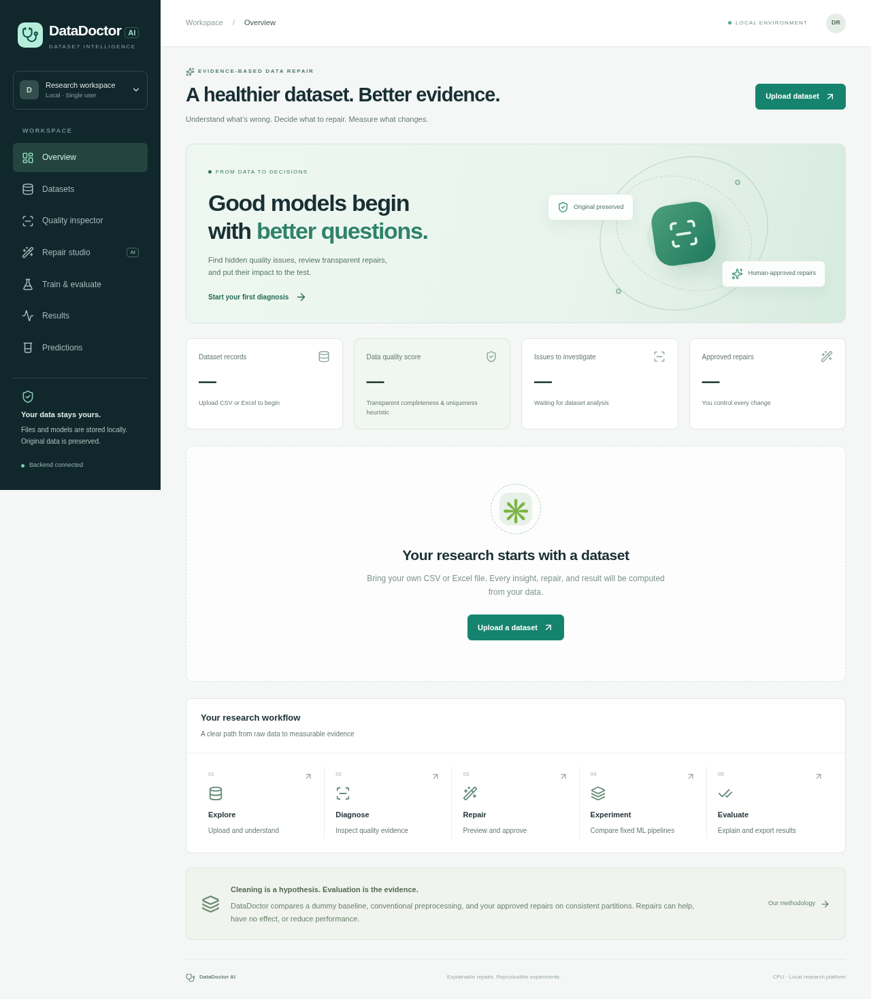
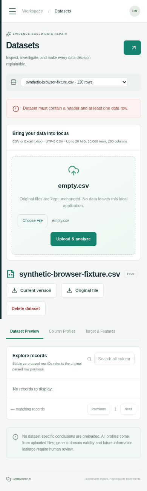

# DataDoctor AI 🩺

**Dataset debugging, human-approved repair, and evidence-based ML evaluation**

[](https://www.python.org/downloads/)
[](https://reactjs.org/)
[](https://fastapi.tiangolo.com/)
[](LICENSE)

[Features](#-features) • [Quick Start](#-quick-start) • [Architecture](#-architecture) • [Usage](#-usage) • [API](#-api-endpoints)

---

## 📖 About

DataDoctor is a **local, single-user research application** for:
- 🔍 Inspecting tabular data quality
- ⚠️ Investigating quality warnings
- 🛠️ Reviewing reversible repairs
- 📊 Measuring whether repairs improve ML performance

Includes a working **React dashboard**, **FastAPI backend**, SQLite history, background jobs, real scikit-learn training, saved-pipeline inference, and downloadable artifacts.

### Research Question
> **Can data-aware repair recommendations improve downstream predictive performance compared with conventional preprocessing?**

---

## ✨ Features

### 📂 Data Management
- ✅ CSV and Excel `.xlsx` uploads (20 MiB max)
- ✅ Multi-sheet Excel support
- ✅ Immutable source preservation
- ✅ Version control with rollback

### 🔍 Quality Analysis
- ✅ Missing value patterns
- ✅ Duplicate detection (exact & normalized)
- ✅ Anomaly detection (IQR + Isolation Forest)
- ✅ Data leakage warnings
- ✅ Class imbalance detection
- ✅ Correlation analysis

### 🛠️ AI-Powered Repairs
- ✅ Smart imputation recommendations
- ✅ Outlier handling (IQR clipping)
- ✅ Whitespace normalization
- ✅ Feature exclusion suggestions
- ✅ Human approval required (no auto-apply)
- ✅ Preview changes before applying

### 🤖 Machine Learning
- ✅ **Classification:** Logistic, Decision Tree, Random Forest, Gradient Boosting
- ✅ **Regression:** Linear, Ridge, Decision Tree, Random Forest, Gradient Boosting
- ✅ Three-arm experiment design
- ✅ Multiple split strategies (Random, Grouped, Chronological)
- ✅ Feature importance analysis
- ✅ Model export (.joblib)

### 📊 Results & Visualization
- ✅ Performance metrics comparison
- ✅ ROC/PR curves
- ✅ Confusion matrices
- ✅ Distribution shift diagnostics
- ✅ Downloadable JSON reports
- ✅ Batch predictions

---

## 🏗️ Architecture

### System Overview

```
┌─────────────────────────────────────────────────────────────┐
│                      User's Browser                         │
│                   (http://localhost:5173)                   │
└────────────────────────┬────────────────────────────────────┘
                         │ HTTP/JSON
                         ▼
┌─────────────────────────────────────────────────────────────┐
│                    Vite Dev Server                          │
│                  (Frontend - React 19)                      │
│  ┌─────────────────────────────────────────────────────┐   │
│  │  React Router  │  Context API  │  Recharts          │   │
│  │  8 Pages       │  State Mgmt   │  Visualization     │   │
│  └─────────────────────────────────────────────────────┘   │
└────────────────────────┬────────────────────────────────────┘
                         │ Proxied /api requests
                         ▼
┌─────────────────────────────────────────────────────────────┐
│              FastAPI Backend (Port 8000)                    │
│  ┌─────────────────────────────────────────────────────┐   │
│  │  REST API Endpoints  │  Job Executor  │  CORS       │   │
│  └─────────────────────────────────────────────────────┘   │
│                         │                                   │
│  ┌──────────────────┬──┴───────────┬───────────────────┐   │
│  │                  │              │                    │   │
│  ▼                  ▼              ▼                    ▼   │
│  ML Engine      Profiler       Store              Schemas  │
│  (trainer.py)   (profiler.py)  (store.py)        (Pydantic)│
│                                                              │
│  • Training     • Quality      • SQLite DB       • Validation│
│  • Evaluation   • Diagnostics  • File Storage    • Types    │
│  • Prediction   • Repairs      • Versioning                 │
└────────────────────────┬────────────────────────────────────┘
                         │
                         ▼
┌─────────────────────────────────────────────────────────────┐
│                   Data Storage Layer                        │
│  ┌─────────────┬─────────────┬─────────────┬───────────┐   │
│  │  SQLite DB  │  Datasets   │   Models    │  Reports  │   │
│  │  (metadata) │  (.pkl)     │  (.joblib)  │  (.json)  │   │
│  └─────────────┴─────────────┴─────────────┴───────────┘   │
└─────────────────────────────────────────────────────────────┘
```

### Backend Architecture

```
backend/
├── app/
│   ├── main.py                 # 🚀 FastAPI Application
│   │   ├── REST API Endpoints (25+)
│   │   ├── Background Job Executor (ThreadPoolExecutor)
│   │   ├── CORS Middleware
│   │   ├── Request Validation
│   │   └── Error Handlers
│   │
│   ├── schemas.py              # 📋 Data Models
│   │   ├── Selection (target, features, task)
│   │   ├── Operation (repair operations)
│   │   ├── RepairRequest (list of operations)
│   │   └── TrainingConfig (ML hyperparameters)
│   │
│   ├── store.py                # 💾 Persistence Layer
│   │   ├── SQLite Database (metadata)
│   │   ├── Filesystem Storage (artifacts)
│   │   ├── Version Control
│   │   └── Job Recovery
│   │
│   └── ml/                     # 🤖 Machine Learning Core
│       ├── profiler.py         # Data Quality Analysis
│       │   ├── Missing value patterns
│       │   ├── Duplicate detection
│       │   ├── Anomaly detection (IQR, Isolation Forest)
│       │   ├── Leakage warnings
│       │   └── Repair recommendations
│       │
│       ├── repairs.py          # Data Transformations
│       │   ├── Imputation (mean, median, mode)
│       │   ├── Outlier clipping (IQR-based)
│       │   ├── Whitespace trimming
│       │   ├── Duplicate removal
│       │   └── Feature exclusion
│       │
│       └── trainer.py          # ML Training & Evaluation
│           ├── Three-arm experiment design
│           ├── Data splitting (Random, Grouped, Time)
│           ├── Pipeline building
│           ├── Model training (6 algorithms)
│           ├── Evaluation metrics
│           └── Model serialization
│
└── tests/                      # 🧪 Test Suite
    ├── test_api.py             # API endpoint tests
    ├── test_data.py            # Data parsing tests
    ├── test_ml.py              # ML algorithm tests
    └── test_store.py           # Storage tests
```

### Frontend Architecture

```
frontend/
├── src/
│   ├── App.jsx                 # 🎨 Main Application Shell
│   │   ├── Navigation sidebar
│   │   ├── Dataset selector
│   │   ├── Job polling (2s interval)
│   │   └── Global error handling
│   │
│   ├── context.jsx             # 🔄 Global State Management
│   │   ├── datasets             # All uploaded datasets
│   │   ├── dataset              # Currently selected dataset
│   │   ├── profile              # Quality analysis results
│   │   ├── jobs                 # Background job statuses
│   │   ├── experiments          # Training run history
│   │   └── refresh()            # Reload data function
│   │
│   ├── api.js                  # 🌐 Backend API Client
│   │   ├── Fetch wrapper with error handling
│   │   ├── Automatic JSON parsing
│   │   └── Base URL configuration
│   │
│   ├── pages/                  # 📄 Route Components
│   │   ├── Overview.jsx        # Dashboard landing
│   │   ├── Datasets.jsx        # Upload & manage datasets
│   │   ├── Inspector.jsx       # Quality warnings viewer
│   │   ├── Repairs.jsx         # 🤖 AI-powered repair studio
│   │   ├── Training.jsx        # ML configuration
│   │   ├── Results.jsx         # Experiment results
│   │   ├── Predictions.jsx     # Model inference
│   │   └── Research.jsx        # History & reports
│   │
│   ├── components/
│   │   └── UI.jsx              # Reusable UI components
│   │
│   └── style.css               # Tailwind + Custom Styles
│
└── tests/
    └── workflow.spec.js        # E2E Playwright tests
```

### Three-Arm Experiment Design

```
                    Original Dataset
                          │
            ┌─────────────┼─────────────┐
            │             │             │
            ▼             ▼             ▼
      ┌─────────┐   ┌─────────┐   ┌─────────┐
      │  ARM A  │   │  ARM B  │   │  ARM C  │
      │Baseline │   │Standard │   │DataDoctr│
      └─────────┘   └─────────┘   └─────────┘
            │             │             │
            │             │             │
   DummyClassifier  Your Algorithm  Your Algorithm
   or DummyRegr.    + Standard      + Approved Repairs
                    Preprocessing   + Preprocessing
            │             │             │
            └─────────────┼─────────────┘
                          │
                          ▼
                  Same Test Data
                  (Held-out Set)

Comparison: Does Arm C outperform Arm B?
```

---

## 🚀 Quick Start

### Prerequisites

| Tool | Version | Download |
|------|---------|----------|
| Python | 3.12 | [python.org](https://www.python.org/downloads/) |
| Node.js | 22+ | [nodejs.org](https://nodejs.org/) |
| npm | (included with Node) | - |

### Installation

#### Windows PowerShell

```powershell
# Clone repository
git clone https://github.com/Piyush-0665/DATADoctor.git
cd DATADoctor

# Backend setup
py -3.12 -m venv .venv
.\.venv\Scripts\Activate.ps1
python -m pip install -r backend\requirements-lock.txt

# Frontend setup
cd frontend
npm ci
cd ..
```

#### Linux / macOS

```bash
# Clone repository
git clone https://github.com/Piyush-0665/DATADoctor.git
cd DATADoctor

# Backend setup
python3 -m venv .venv
source .venv/bin/activate
python -m pip install -r backend/requirements-lock.txt

# Frontend setup
cd frontend
npm ci
cd ..
```

### Running the Application

Open **two terminals**:

**Terminal 1 - Backend:**
```bash
# Activate venv first (if not already)
# Windows: .\.venv\Scripts\Activate.ps1
# Linux/Mac: source .venv/bin/activate

python -m uvicorn app.main:app --app-dir backend --host 127.0.0.1 --port 8000
```

**Terminal 2 - Frontend:**
```bash
cd frontend
npm run dev -- --port 5173 --strictPort
```

### Access Points

| Service | URL | Description |
|---------|-----|-------------|
| 🎨 **Frontend** | http://localhost:5173 | React Dashboard |
| 🚀 **Backend** | http://127.0.0.1:8000 | FastAPI Server |
| 📚 **API Docs** | http://127.0.0.1:8000/docs | Swagger UI |
| ❤️ **Health Check** | http://127.0.0.1:8000/api/health | Status endpoint |

**Stop servers:** Press `Ctrl+C` in both terminals

---

## 📱 Screenshots

### Dashboard Overview


### Mobile Responsive


---

## 📖 Usage

### 1️⃣ Upload Dataset
- Navigate to **Datasets** page
- Drag & drop CSV or Excel file
- For Excel: select worksheet if multiple sheets
- Wait for automatic profiling to complete

### 2️⃣ Inspect Quality
- Go to **Quality Inspector**
- Review warnings:
  - ⚠️ Missing values
  - 🔄 Duplicate records
  - 📊 Anomalies (outliers)
  - ⚡ Data leakage risks
- Click warnings to see affected rows

### 3️⃣ Configure Target & Features
- Select **target variable** (what to predict)
- Choose **task type**: Classification or Regression
- Pick **input features** (X variables)
- Optional: Set **identifier column** for grouping

### 4️⃣ Apply Repairs (AI-Powered) 🤖
- Navigate to **Repair Studio**
- Review AI recommendations
- Check boxes to approve operations:
  - 💉 **Impute** missing values
  - ✂️ **Clip** outliers
  - 🗑️ **Drop** duplicates
  - ❌ **Exclude** problematic features
- Preview changes
- Apply (creates new version, original preserved)

### 5️⃣ Train ML Models
- Go to **Train & Evaluate**
- Select **algorithm** (Logistic, Forest, etc.)
- Choose **split strategy**:
  - 🎲 Random (stratified)
  - 👥 Entity-grouped (prevent user leakage)
  - 📅 Chronological (time-series)
- Set **hyperparameters**
- Start training (runs in background)

### 6️⃣ View Results
- Navigate to **Results**
- Compare three arms:
  - Baseline vs Standard vs DataDoctor
- View metrics:
  - Accuracy, Precision, Recall, F1
  - ROC/PR curves
  - Feature importance
- Download JSON report

### 7️⃣ Make Predictions
- Go to **Predictions**
- **Single:** Fill form with values
- **Batch:** Upload CSV (max 5K rows)
- Select prediction arm
- Download results

### 8️⃣ Download Artifacts
- Visit **History & Reports**
- Download:
  - 📊 Quality reports (JSON)
  - 🤖 Trained models (.joblib)
  - 📄 Dataset versions (CSV)
  - 📈 Experiment reports

---

## 🔌 API Endpoints

### Datasets

| Method | Endpoint | Description |
|--------|----------|-------------|
| `POST` | `/api/datasets` | Upload CSV/XLSX |
| `GET` | `/api/datasets` | List all datasets |
| `GET` | `/api/datasets/{id}` | Get dataset details |
| `DELETE` | `/api/datasets/{id}` | Delete dataset |
| `PUT` | `/api/datasets/{id}/selection` | Set target & features |
| `GET` | `/api/datasets/{id}/records` | View records (paginated) |
| `GET` | `/api/datasets/{id}/download` | Export as CSV |

### Profiling

| Method | Endpoint | Description |
|--------|----------|-------------|
| `POST` | `/api/datasets/{id}/analysis` | Trigger profiling |
| `GET` | `/api/datasets/{id}/profile` | Get quality report |
| `GET` | `/api/datasets/{id}/issues/{issue_id}/records` | View affected rows |

### Repairs

| Method | Endpoint | Description |
|--------|----------|-------------|
| `POST` | `/api/datasets/{id}/repairs/preview` | Preview repairs |
| `POST` | `/api/datasets/{id}/repairs` | Apply repairs |
| `POST` | `/api/datasets/{id}/restore` | Restore original |

### Training

| Method | Endpoint | Description |
|--------|----------|-------------|
| `GET` | `/api/algorithms` | List available algorithms |
| `POST` | `/api/training/validate` | Validate config |
| `POST` | `/api/training` | Start training job |

### Experiments

| Method | Endpoint | Description |
|--------|----------|-------------|
| `GET` | `/api/experiments` | List all experiments |
| `GET` | `/api/experiments/{id}` | Get results |
| `GET` | `/api/experiments/{id}/report` | Download JSON |
| `GET` | `/api/experiments/{id}/model` | Download .joblib |

### Predictions

| Method | Endpoint | Description |
|--------|----------|-------------|
| `POST` | `/api/experiments/{id}/predict` | Single/batch predict |
| `POST` | `/api/experiments/{id}/predict-batch` | CSV batch predict |

### System

| Method | Endpoint | Description |
|--------|----------|-------------|
| `GET` | `/api/health` | Health check |
| `GET` | `/api/jobs` | List background jobs |
| `GET` | `/api/jobs/{id}` | Job status & logs |

📚 **Full API Documentation:** Available at `http://127.0.0.1:8000/docs` (Swagger UI)

---

## 🧪 Testing

### Backend Tests
```bash
cd backend
python -m pytest -q
```

**Coverage includes:**
- ✅ CSV/Excel parsing
- ✅ Data validation
- ✅ Quality diagnostics
- ✅ Repair operations
- ✅ All ML algorithms
- ✅ API endpoints
- ✅ Job recovery

### Frontend E2E Tests
```bash
cd frontend
npm run build
npm run test:e2e
```

**Playwright tests:**
- ✅ Full workflow (upload → repair → train → predict)
- ✅ UI interactions
- ✅ API integration
- ✅ Background job handling

---

## 🛠️ Tech Stack

### Backend
- **FastAPI** 0.141 - Modern async web framework
- **Pandas** 2.2 - DataFrame operations
- **scikit-learn** 1.8 - ML algorithms
- **NumPy** 2.3 - Numerical computing
- **SciPy** 1.17 - Statistical functions
- **Pydantic** 2.14 - Data validation
- **Uvicorn** 0.52 - ASGI server
- **SQLite** - Embedded database
- **Joblib** 1.5 - Model serialization

### Frontend
- **React** 19.1 - UI library
- **Vite** 7.1 - Build tool & dev server
- **Tailwind CSS** 4.1 - Utility-first CSS
- **React Router** 7.9 - Client-side routing
- **Recharts** 3.3 - Chart library
- **Lucide React** 0.548 - Icon library
- **Playwright** 1.56 - E2E testing

---

## ⚠️ Limitations

| Limit | Value | Reason |
|-------|-------|--------|
| Upload size | 20 MiB | Local CPU processing |
| Max rows | 50,000 | Interactive performance |
| Max columns | 200 | UI practicality |
| Max features (training) | 60 | Prevent overfitting |
| Max classes | 50 | One-hot encoding limit |
| Min samples/class | 5 | Statistical validity |
| Concurrent training jobs | 1 | Resource management |

### Important Notes
- 🔒 **No authentication** - Local single-user only
- 🔒 **No encryption** - Don't use with sensitive data
- 🚫 **No automatic repairs** - Human approval required
- ⏸️ **No job resume** - Interrupted jobs must restart
- 🏠 **Local only** - Not for production deployment

---

## 📚 Documentation

- **[Research Protocol](docs/RESEARCH.md)** - Methodology details
- **[Validation](docs/VALIDATION.md)** - Testing boundaries
- **[API Docs](http://127.0.0.1:8000/docs)** - Interactive Swagger UI

---

## 🤝 Contributing

Contributions welcome! Please:
1. Fork the repository
2. Create a feature branch
3. Make your changes
4. Add tests if applicable
5. Submit a pull request

---

## 📄 License

See [LICENSE](LICENSE) file for details.

---

## 📧 Contact

- **GitHub:** [@Piyush-0665](https://github.com/Piyush-0665)
- **Repository:** [github.com/Piyush-0665/DATADoctor](https://github.com/Piyush-0665/DATADoctor)

---

<div align="center">

**Made with ❤️ for better data science**

⭐ Star this repo if you find it helpful!

</div>
